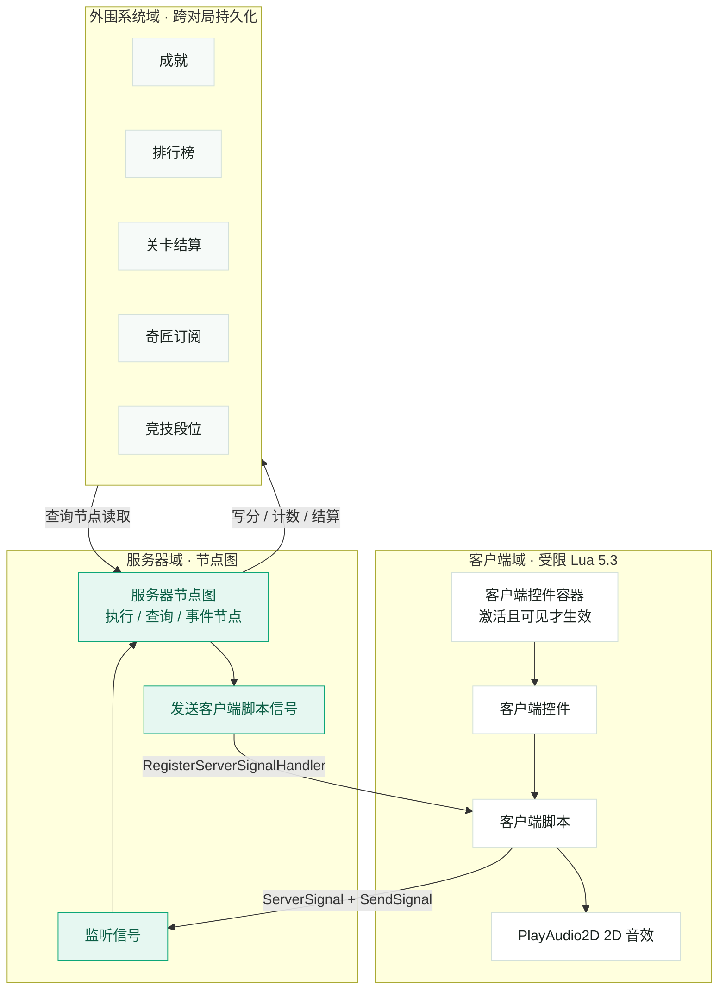

# 坦克动荡 · 千星奇域版 — 外围功能接入指南

> 千星奇域的音乐音效、成就、排行榜、订阅与结算等外围能力，全部由「服务器节点图 + 编辑器配置」驱动，客户端 Lua 只能操作客户端控件、播放 2D 音效并与服务器互发信号。因此分工天然清晰：你在编辑器里配置规则、资产与呈现，IDE 在节点图与 Lua 里负责触发、读写与状态同步。

- **文档性质**：AI 生成的接入指南（「你 / IDE」分工 + 配置清单）
- **适用平台**：原神千星奇域 UGC（受限 Lua 5.3 + 服务器节点图）
- **共 8 章**（含来源）

本文把外围系统的接入拆成三层：客户端域（受限 Lua）、服务器域（节点图）、外围系统域（跨对局持久化），逐章给出编辑器侧与代码侧的分工、以及最容易踩的坑。

## 目录

1. [总览：三层架构与分工边界](#1-总览三层架构与分工边界)
2. [音乐音效接入](#2-音乐音效接入)
3. [成就系统接入](#3-成就系统接入)
4. [排行榜接入](#4-排行榜接入)
5. [奇匠订阅接入](#5-奇匠订阅接入)
6. [关卡结算接入](#6-关卡结算接入)
7. [补充外围系统](#7-补充外围系统)
8. [里程碑、验收清单与风险](#8-里程碑验收清单与风险)

---

## 1. 总览：三层架构与分工边界

先说结论：**外围系统不是客户端能碰的东西**。成就、排行榜、竞技段位、关卡结算、奇域任务、奇域礼盒这些能力，全部由服务器节点图在运行时读写，再叠加编辑器里的静态配置。客户端脚本（受限 Lua 5.3）能做的事情只有三件：操作挂在「客户端控件容器」下的客户端控件、播放 2D 音效、以及通过信号与服务器节点图通信。[1][2][3]

这决定了两条不可绕过的通道：客户端要影响游戏世界，必须先把事件发给服务器节点图；服务器要把结果告诉玩家界面，必须再发一次「客户端脚本信号」回到客户端。两侧节点图之间则可以通过「信号」解耦通信——信号是全局自定义结构，以「信号名」作为唯一标识，任何实体的服务端节点图都能发送与监听。[1]

> **图 1 · 三层架构与信号通道。** 绿色域为服务器节点图（外围系统的唯一入口），白色域为客户端表现层，浅色域为跨对局持久化的外围数据。实线箭头表示数据流方向。

注意图 1 中间那条回程链路：服务器给客户端发信号用的是节点图里的【发送客户端脚本信号】节点，客户端用 `script:RegisterServerSignalHandler` 接收。而在联机环境下，服务器发送信号的最低延迟是 **100ms**，这意味着任何依赖服务器回环的界面反馈都有可感知的滞后。[2]

> **三条硬约束（先记住）**
> - 只有 **在千星沙箱建立了映射** 的 lua 文件才会被打包上传，本地写了但没映射的脚本不会生效。[2]
> - 客户端控件依附于容器：容器隐藏或销毁会让控件销毁；**传送与断线重连会销毁全部客户端控件并回到初始状态**，界面恢复要自己处理。[2]
> - **排行榜与竞技段位只能二选一开放**，规划阶段就要定下来，之后不能同时启用。[7][10]

### 本游戏的分工速览

表 1 · 五大需求的分工速览

| 功能 | 编辑器侧（你） | 代码侧（IDE） |
| --- | --- | --- |
| 音乐音效 | 建背景音乐管理条目、给单位挂音效播放器组件、备好音频资产 | 在开火/命中/拾取/回合起止等事件调用音频节点；客户端播 UI 音 |
| 成就 | 写成就清单：名称、序号、稀有度、计数阈值、描述 | 在对应事件调用增加/设置成就计数、【查询成就是否完成】 |
| 排行榜 | 决定榜种、序号、排序规则、显示格式、重置类型 | 在结算流程里以整数或浮点数写入排行榜分数 |
| 奇匠订阅 | 发布动态（每周 ≤3 条）、放置局内订阅按钮 | 用【查询玩家是否订阅】解锁订阅者专属内容 |
| 结算 | 配结算界面类型、游戏内排名、排名比较顺序 | 先写排名数值与成功状态，最后调用【结算关卡】 |

下面每一章都按同样的结构展开：先讲要配什么，再给一个「你 / IDE」的分工卡，最后标注这一章最容易踩的坑。

---

## 2. 音乐音效接入

音频在这个游戏里分三层，用途和配置入口完全不同，不要混用：**背景音乐**（关卡的 BGM，跨全局，可多首按时间范围切换）、**音效播放器组件**（挂在单位上、支持 3D 定位与衰减）、**客户端 2D 音效**（UI 音，由客户端脚本播放）。[4][5][3]

表 2 · 三层音频的适用场景与分工

| 层 | 你配置什么 | IDE 触发什么 |
| --- | --- | --- |
| 背景音乐 | 系统菜单 →【背景音乐管理】：音乐库资产、生效时间范围（截取片段）、音量、播放速度、是否淡入淡出、是否循环、间隔时间 | 【启动/暂停玩家背景音乐】【设置玩家背景音乐】【调整玩家背景音乐音量】 |
| 音效播放器（3D，跟随单位） | 给坦克、炮弹、补给箱、基地挂组件，填序号、名称、音效资产、音量、播放速度、循环、3D 范围半径、挂接点、衰减方式 | 【添加音效播放器】【启动/暂停指定音效播放器】【调整指定音效播放器】【关闭指定音效播放器】 |
| 客户端 2D 音效（UI 音） | 准备音频资产；决定哪些是界面音（按钮、菜单、提示） | 客户端脚本调用 `game.PlayAudio2D` / `StopAudio` / `IsAudioAlive`；或用【玩家播放单次2D音效】 |

### 2.1 背景音乐（BGM）

入口是左上角系统菜单 →【背景音乐管理】。每条配置包含音乐资产、生效时间范围、音量、播放速度（默认 1）、是否淡入淡出、是否循环播放、以及循环间隔时间（秒）。联机状态下不同玩家可以听到不同的 BGM——这意味着 BGM 是「按玩家」生效的，节点图里对应的节点也都带「玩家」参数。[4]

本作的建议用法：把主菜单与战斗分成两段，用「生效时间范围」截取同一首曲子的不同段落，或者配置两首独立曲子，由节点图按回合状态切换。

### 2.2 音效播放器组件（3D 音效）

组件有两种播放方式：一是组件默认配置，持有该单位的实体被创建后自动播放；二是节点图播放，前提是单位必须持有该组件。字段包括序号、名称、音效资产、音量、播放速度、循环播放、循环时间间隔，以及一组 3D 音效参数——范围预览、范围半径（米）、挂接点、衰减方式（均匀衰减 / 先快后慢 / 先慢后快）和偏移。[5]

炮弹飞行、爆炸、引擎轰鸣这类需要方向感的声音用这一层；而开火、命中提示这类「玩家自己触发的确定性事件」用第三层的 2D 音效更省事，也更容易做本地即时反馈。

### 2.3 客户端 2D 音效（UI 音）

客户端脚本侧只有三个音频 API：`game.PlayAudio2D(audioId)` 返回音效实例 ID，`game.StopAudio(instanceId)` 停止，`game.IsAudioAlive(instanceId)` 查询是否还在播。[3] 这是一个「拿句柄管生命周期」的模型：如果不管句柄，长音效或连续点击会互相叠加，所以 IDE 需要保存实例 ID 并做去重。

**你 · 编辑器侧**

- 把音乐与音效资产上传到音乐库/音效库，确认命名可辨识。
- 在【背景音乐管理】里配置主菜单与战斗两套 BGM，决定淡入淡出与循环。
- 给坦克、炮弹、补给箱、基地分别挂音效播放器组件，填好 3D 半径与衰减方式。
- 整理一份「界面音清单」，标明每个界面音的触发时机，交给 IDE。

**IDE · 节点图 / Lua 侧**

- 在回合开始/结束、开火、命中、被击毁、拾取补给等事件节点后接音频节点。
- 客户端 UI 音用 `PlayAudio2D`，并用返回的实例 ID 调 `StopAudio` 防叠加。
- 用 `IsAudioAlive` 判断长音效是否结束，再决定是否续播。
- 监听服务器信号（`RegisterServerSignalHandler`）后播放对应提示音。

> **音画同步的坑**
> 联机时客户端信号往返服务器最低要 100ms。[2] 所以「自己开火」「点了按钮」这类本地可预测的事件，应让客户端直接播本地音效，不要等服务器回环；服务器回程的信号只用于「别人做了什么」这类无法本地预测的事件。把这一条写进音效设计约定，能省掉一整轮返工。

---

## 3. 成就系统接入

成就是跨对局累积的玩家进度，由编辑器配置定义、由服务器节点图推进。入口是系统菜单 →【外围系统管理】→ 成就页签。[6]

### 3.1 需要配置什么

一个关卡支持多个**普通成就**，外加一个**极致成就**。极致成就在所有普通成就完成后自动达成；但它有前置条件——**至少要设置 5 个普通成就，并且完成名称与图片配置之后，极致成就才会生效**。所以如果你的成就是系列化的，记得凑满 5 个，否则极致成就不会出现。[6]

表 3 · 普通成就的字段与含义

| 字段 | 说明 |
| --- | --- |
| 成就名称 | 玩家看到的成就名。 |
| 序号 | 节点图内用于定位该成就的标识，必须与代码里传入的序号一一对应。 |
| 稀有度 | 耀金 / 星银 / 辉铜三档。 |
| 成就计数 | 初值为 0，累加至配置值即视为完成。 |
| 成就描述 | 达成条件的文字说明。 |

另有全局开关「是否开启成就」与「允许房间内游玩结算成就」。后者关闭时，通过房间内游玩产生的行为不会推进成就——联机自测时尤其容易忽略这一点。[6]

### 3.2 代码侧要用哪些节点

表 4 · 成就相关服务器节点

| 节点 | 类型 | 用途 |
| --- | --- | --- |
| 设置成就进度计数 | 执行节点 | 把计数直接置为某个绝对值（用于结算时对齐）。[15] |
| 变更成就进度计数 | 执行节点 | 在计数上做增量累加，最常用的写法。[15] |
| 查询成就是否完成 | 查询节点 | 做门槛判断，例如解锁专属涂装或彩蛋。[16] |

**你 · 编辑器侧**

- 把原版 TankTrouble2 的隐藏要素翻译成成就清单，例如「累计击毁 100 辆敌方坦克」「单局零阵亡获胜」「累计拾取 50 个补给箱」。
- 为每条成就填名称、序号、稀有度、计数阈值、描述，并配好图片。
- 若要启用极致成就，确保普通成就数量 ≥ 5 且名称/图片齐备。
- 确认「是否开启成就」与「允许房间内游玩结算成就」两个开关符合你的测试计划。

**IDE · 节点图 / Lua 侧**

- 在击毁、拾取、获胜等事件后接【变更成就进度计数】做增量累加。
- 结算点需要对齐进度时用【设置成就进度计数】写绝对值。
- 用【查询成就是否完成】驱动条件分支（专属外观、隐藏关卡、彩蛋）。
- 序号常量集中定义在一个位置，避免节点里散落魔法数字。

> **序号是唯一契约**
> 编辑器里的「序号」是节点图定位成就的唯一依据。改序号等于换了另一个成就，历史进度不会跟着迁移。规划期就把序号表定死并同步给 IDE。

---

## 4. 排行榜接入

排行榜会持久展示在大厅里，同样由服务器节点图写入。[7] 最关键的一条限制：**排行榜与竞技段位只能二选一开放**，两者不能同时启用。[7][10]

### 4.1 需要配置什么

你可以建立多个排行榜模板，但每次设置数据时必须指定**序号**来区分写向哪一个榜。每条榜配置包含以下字段：[7]

表 5 · 排行榜字段

| 字段 | 可选值 / 说明 |
| --- | --- |
| 排行榜名称 | 展示名称。 |
| 序号 | 节点图写数据时用来定位该榜。 |
| 显示优先级 | 决定在大厅中的排列顺序。 |
| 显示格式 | 纯数值 / 时间 / 百分比。 |
| 榜单重置类型 | 不重置 / 随赛季重置。 |
| 成绩排序规则 | 越小越靠前 / 越大越靠前。 |

另外，**每个排行榜只记录排名前 1000 位**，排在 1000 名之后的成绩不会展示。[7]

### 4.2 代码侧要用哪些节点

表 6 · 排行榜相关服务器节点

| 节点 | 类型 | 用途 |
| --- | --- | --- |
| 以整数设置玩家排行榜分数 | 执行节点 | 写整数成绩，如击毁数、胜场数。[15] |
| 以浮点数设置玩家排行榜分数 | 执行节点 | 写浮点成绩，如时间、比率。[15] |

**你 · 编辑器侧**

- 先做二选一决策：本作开排行榜还是开竞技段位。
- 确定榜种，例如「最高单局击毁数」（越大越靠前）与「最快通关时间」（越小越靠前）。
- 配置显示格式：时间榜用「时间」，比率类用「百分比」，其余用「纯数值」。
- 决定重置类型：留存型用「不重置」，赛季型用「随赛季重置」。

**IDE · 节点图 / Lua 侧**

- 只在约定的结算时机写分，避免中途反复写导致成绩抖动。
- 按序号分别写入多个榜，序号常量集中定义。
- 时间类成绩统一单位（秒或毫秒），并确认与「越小越靠前」一致。
- 写分逻辑放在【结算关卡】之前，保证成绩落地。

> **二选一，别做两手准备**
> 排行榜与竞技段位互斥是引擎层面的约束。[7][10] 如果先按排行榜做了一轮，再想切到段位，结算侧的数据写入都要改。规划期就定，不要留到实现期。

---

## 5. 奇匠订阅接入

订阅的用途是建立流量私域：玩家订阅你之后，你发布的动态会推送给订阅者。[9] 对关卡本身来说，它的实际价值是**「怎么识别订阅者，并给订阅者专属内容」**。

### 5.1 需要配置什么

- **动态发布**：发布或更新关卡时可以勾选发布动态。每位创作者**每周最多 3 条**动态，配额在周一凌晨 4:00 刷新，删除动态不返还配额。管理入口在「人气奇域 — 订阅动态 — 我的动态」。[9]
- **局内订阅按钮**：在 界面控件组管理 → 添加界面控件 → **预制模板** 中新增，支持在悬浮交互页中展示，试玩环境同样生效。按钮外观会随后台的粉丝数与活跃度变化。[9]
- **订阅状态查询**：服务器节点【查询玩家是否订阅】用来判断某个玩家是否已订阅。[16]

**你 · 编辑器侧**

- 在预制模板里加入局内订阅按钮，并安排它在主界面/结算界面的位置。
- 规划动态节奏，把每周 3 条的配额用在版本更新与活动节点上。
- 设计订阅者专属内容（专属涂装、称号、彩蛋关卡），并写成清单。

**IDE · 节点图 / Lua 侧**

- 用【查询玩家是否订阅】做条件分支，解锁订阅者专属内容。
- 把订阅状态通过服务器信号广播给客户端，用于界面提示。
- 结合【界面控件组触发时】等事件节点刷新入口状态。
- 注意局内订阅按钮本身就是控件，需要落在激活且可见的容器内。

> **自测时的假阴性**
> 【查询玩家是否订阅】对**创作者本人默认输出「是」**。[16] 如果你用自己的账号测试「非订阅者分支」，永远走不进去。要么用小号测，要么在节点图里临时把判断结果强行置反。

---

## 6. 关卡结算接入

结算由节点图触发，触发后**整关结束**，结果会传递给外围系统去更新排行榜或竞技段位。它是把局内表现转化为持久化数据的唯一出口。[8]

### 6.1 两种「结算」不要混淆

一是**结算数据**：每个玩家身上有两个结算属性——**逃跑合法性**与**结算状态**。逃跑合法性为「否」时，该玩家直接进入全员逃跑状态；只有当合法性为「是」时，结算状态（胜利 / 失败 / 未定）才有意义，它也是加段位分的判据。[8]

二是**关卡结算表现**：它在系统菜单 →【关卡设置】→ 结算页签里配置，**只影响局内展示，不影响外围数据**。包含结算界面类型（阵营结算 / 个人结算）、是否启用游戏内排名、以及排名数值比较顺序（由小到大 / 由大到小）。[8]

### 6.2 代码侧要用哪些节点

表 7 · 结算相关服务器节点

| 节点 | 类型 | 用途 |
| --- | --- | --- |
| 结算关卡 | 执行节点 | 触发结算并结束本关，必须是最后一步。[15] |
| 设置玩家结算排名数值 | 执行节点 | 写单个玩家的排名数值。[15] |
| 设置阵营结算排名数值 | 执行节点 | 写阵营维度的排名数值。[15] |
| 设置玩家结算成功状态 | 执行节点 | 写单玩家的胜利/失败/未定。[15] |
| 设置阵营结算成功状态 | 执行节点 | 写阵营维度的胜负。[15] |
| 设置玩家结算计分板展示数据 | 执行节点 | 写结算界面上那张计分板要展示的数据。[15] |
| 设置玩家逃跑合法性 | 执行节点 | 判定该玩家是否算逃跑。[15] |
| 获取玩家结算排名数值 / 结算成功状态 | 查询节点 | 回读当前结算数据，做中途展示。[16] |
| 获取阵营结算排名数值 / 阵营结算成功状态 | 查询节点 | 回读阵营维度的结算数据。[16] |

**你 · 编辑器侧**

- 决定胜负判据：本作是回合制，建议以「先达到 N 分」或「回合时间耗尽时领先」作为判定。
- 配置结算界面类型（单人对抗建议个人结算）、是否启用游戏内排名、排名比较顺序。
- 决定结算后要写向哪些外围系统：排行榜分数、竞技段位分数、成就进度。
- 设计计分板要展示哪些列（击毁数、死亡数、命中率等）。

**IDE · 节点图 / Lua 侧**

- 在回合结束条件满足时，**先**写排名数值、成功状态、计分板数据与逃跑合法性。
- **最后**才调用【结算关卡】。
- 中途要展示实时排名，用查询节点回读，不要自行推算。
- 把结算写入的排行榜序号、段位计分组与第 3、4、7 章的配置对齐。

> **顺序错了就白写**
> 【结算关卡】一旦触发，整关结束，之后的节点不再执行。[8] 所以所有要落到外围系统的数据必须在它**之前**写完。把这条写成节点图的硬性约定：任何新增的结算期写入都插在【结算关卡】之上。

---

## 7. 补充外围系统

你列的五项之外，这套框架里还有六个直接相关的系统。它们和主线的耦合度不同，按需接入即可，但规划时最好一起看，因为彼此有约束关系。[18]

表 8 · 补充系统的关键上限（规划前必读）

| 系统 | 关键上限 / 约束 |
| --- | --- |
| 竞技段位 | 与排行榜二选一；段位分以「计分组模板」预设，每玩家应用一份。 |
| 奇域任务 | 单奇域最多 20 个；每日/每周按固定时间刷新。 |
| 奇域礼盒 | 每关最多 20 个；任务奖励必须关联礼盒才生效。 |
| 局内存档 | 有总数据量与列表长度上限；升级只允许纯增量。 |

### 7.1 竞技段位

段位积分在结算时按结算状态给分，分数规则可定制。改动段位分要依托**计分组模板**，每个玩家应用一份。计分组字段包括：计分组名称、序号、胜利分数、失败分数、未定分数、逃跑分数，以及包含的玩家。[10]

官方给了一组建议分数，按单局时长分档，可以直接作为起点：[10]

表 9 · 竞技段位官方建议分数（节选）

| 单局时长 | 胜利 | 失败 | 未定 / 逃跑 |
| --- | --- | --- | --- |
| 0–2 分钟 | +20 | −5 | 0 / −20 |
| 40–999 分钟 | +200 | −50 | 0 / −200 |

特殊处理包含逃跑扣分、连续胜利、连续逃跑与段位保护。相关节点有：设置玩家逃跑合法性、设置玩家段位变化分数、切换玩家竞技段位生效的计分组（执行节点），以及获取玩家段位变化分数、获取玩家段位信息、获取玩家逃跑合法性（查询节点）。[15][16]

### 7.2 奇域任务

可以给玩家设定任务目标与奖励，按周期自动刷新，**单个奇域最多 20 个任务**。全局开关有「开启游戏内奇域任务入口」与「允许房间内游玩结算奇域任务」。刷新类型分为不刷新、按日刷新（每天 4 点）、按周刷新（每周一 4 点）与赛季刷新。[11]

每条任务包含任务描述、任务计数、任务奖励。奖励需要关联**奇域嘉奖礼盒**，最多 3 类，**且必须关联礼盒才会真正生效**。生效设置还包括显示优先级、是否生效、生效后是否常驻（不常驻时必须选择「当前至往后 10 个赛季」）。节点有：设置任务计数、增加任务计数（计数可为负）、查询指定任务计数、查询指定任务是否完成。[11][15][16]

### 7.3 奇域礼盒

礼盒是奖励的载体，**每关最多 20 个**。字段包括：礼盒索引（唯一；上传存档时必须与线上保持「包含关系」）、选择图标（预置或本地上传）、稀有度、获取条件类型（排行榜 / 竞技段位 / 极致成就）、赛季更新后能否再次获取、持有有效期、持有后的有效赛季数、描述内容，另有生效设置与上架设置（选择赛季、添加）。节点有：消耗礼盒、打开礼盒界面、查询对应礼盒数量、查询对应华丽演绎礼盒消耗数量。[12][15][16]

### 7.4 先行体验

首次发布关卡时勾选「先行体验」，可以填写说明文字。更新时会显示为「X.xx 先行体验版本」；正式发布后计数从 1.01 开始。**正式版无法转回先行体验**，这是一个单向开关，决定前要想清楚。[13]

### 7.5 局内存档

局内存档可以把关卡内的玩家数据持久保存，并在每次进场时带入。它必须用**结构体 + 自定义变量**来定义；可以配置多个局内存档模板，但同一时间只能启用一个。模板内的每个结构体会在玩家实体上生成同名的**局内存档变量**，用法和常规自定义变量一样，但无法直接修改。[14]

> **时序与类型限制**
> **读档**发生在实体创建之前，因此实体创建时就能查到存档值；**存档**在离场时写回。支持的类型包括 GUID、整数、布尔值、浮点数、字符串、阵营、三维向量、元件 ID、配置 ID 及它们的列表；**实体、实体列表、所有字典与结构体都不支持**。数据总量与列表最大长度都有上限，超出时会截断并保留前若干元素。[14]

升级也有限制：**只允许纯增量**——新增结构体或新增成员（新成员按默认值读档）。禁止删除模板、缩短长度、修改引用结构体、修改或删除成员类型，这些操作会导致读档失败并重置。入口在系统菜单 →【局内存档管理】，并提供了「对比模板」功能。[14]

### 7.6 多语言文本

客户端脚本里的文案要走「多语言文本管理 — 脚本文本变量」并在运行时用 `game.GetText(textMapId)` 取。[2][3] 如果 HUD、菜单文案由客户端脚本渲染，这一步不能省，否则无法做多语言。

**你 · 编辑器侧**

- 在排行榜与段位之间二选一，并按选定的那套把配置做完整。
- 建任务清单（≤20）并确保每条奖励都关联了礼盒。
- 建礼盒清单（≤20）并规划上架赛季与持有有效期。
- 决定是否走先行体验，并决定是否启用局内存档（结构体定义好后不要改）。

**IDE · 节点图 / Lua 侧**

- 段位侧：在结算前设置逃跑合法性、段位变化分数，必要时切换计分组。
- 任务侧：在事件后调用增加/设置任务计数，用查询节点驱动入口红点。
- 礼盒侧：用消耗礼盒、打开礼盒界面，并查询数量做展示。
- 存档侧：读取局内存档变量时必须考虑「首次进场无存档」的分支。

---

## 8. 里程碑、验收清单与风险

建议按依赖关系分四批推进，每批都能独立验证，不必等全部做完再联调。

表 10 · 建议里程碑

| 里程碑 | 内容 | 可独立验证点 |
| --- | --- | --- |
| M1 · 听感 | 背景音乐 + 音效播放器 + UI 音 | 开局有 BGM，开火/命中/拾取有声，菜单按钮有声 |
| M2 · 结算闭环 | 结算节点 + 排行榜或段位写入 | 打完一局后大厅榜/段位分发生变化 |
| M3 · 留存 | 成就 + 奇域任务 + 奇域礼盒 | 击毁数推进成就，任务计数增长，礼盒可消耗 |
| M4 · 运营 | 订阅 + 先行体验 + 局内存档 | 订阅者可见专属内容，存档跨局保留 |

表 11 · 验收清单

| 验收项 | 标准 | 负责方 |
| --- | --- | --- |
| 音频三层不混用 | BGM 走背景音乐管理，3D 音走组件，UI 音走客户端 2D 音效 | 双方 |
| 结算写入顺序 | 排名/状态/计分板/逃跑合法性全部在【结算关卡】之前 | IDE |
| 序号一致性 | 成就序号、排行榜序号、计分组序号与节点图常量逐一对齐 | 双方 |
| 二选一决策 | 排行榜与竞技段位只启用其中一个 | 你 |
| 脚本已映射 | 所有客户端 lua 都在沙箱建立了脚本映射 | IDE |
| 界面可恢复 | 传送/断线重连后客户端控件能重新构建 | IDE |
| 容量未超限 | 任务 ≤20、礼盒 ≤20、存档未触发截断 | 你 |

表 12 · 主要风险与规避

| 风险 | 影响 | 规避 |
| --- | --- | --- |
| 联机信号 100ms 延迟 | 界面反馈与音画不同步 | 本地可预测事件走客户端本地播放 |
| 客户端控件被销毁 | 重连后界面消失 | 把界面重建逻辑做成可重复执行的流程 |
| 排行榜/段位互斥 | 中途切换导致结算侧重写 | 规划期一次性定死 |
| 存档结构体变更 | 读档失败并重置玩家数据 | 只做纯增量升级，不做删除或改类型 |
| 序号被改 | 历史进度与成绩错位 | 序号表冻结，变更需同步双方并评估迁移 |

> **下一步**
> 把表 1 的分工速览作为双方的接口清单：你先交出「成就序号表 / 排行榜序号与规则 / 任务与礼盒清单 / 音效清单」，IDE 再按这些契约把节点图接线补齐。契约先行，能避免绝大多数返工。

---

## 来源

1. 官方文档《附录 / 节点图高级特性 / 信号》—— 项目内 `docs/ugc_official/附录/节点图高级特性/信号.md`。
2. 官方文档《概念介绍 / 高级概念 / 界面控件组管理 / 客户端控件和客户端脚本》—— 项目内 `docs/ugc_official/概念介绍/高级概念/界面控件组管理/客户端控件和客户端脚本.md`。
3. 官方文档《附录 / 客户端控件API文档》—— 项目内 `docs/ugc_official/附录/客户端控件API文档.md`。
4. 官方文档《概念介绍 / 其它概念 / 背景音乐》—— 项目内 `docs/ugc_official/概念介绍/其它概念/背景音乐.md`。
5. 官方文档《概念介绍 / 功能 / 通用组件 / 音效播放器》—— 项目内 `docs/ugc_official/概念介绍/功能/通用组件/音效播放器.md`。
6. 官方文档《概念介绍 / 高级概念 / 外围系统 / 成就》—— 项目内 `docs/ugc_official/概念介绍/高级概念/外围系统/成就.md`。
7. 官方文档《概念介绍 / 高级概念 / 外围系统 / 排行榜》—— 项目内 `docs/ugc_official/概念介绍/高级概念/外围系统/排行榜.md`。
8. 官方文档《概念介绍 / 高级概念 / 外围系统 / 关卡结算》—— 项目内 `docs/ugc_official/概念介绍/高级概念/外围系统/关卡结算.md`。
9. 官方文档《概念介绍 / 高级概念 / 外围系统 / 奇匠订阅》—— 项目内 `docs/ugc_official/概念介绍/高级概念/外围系统/奇匠订阅.md`。
10. 官方文档《概念介绍 / 高级概念 / 外围系统 / 竞技段位》—— 项目内 `docs/ugc_official/概念介绍/高级概念/外围系统/竞技段位.md`。
11. 官方文档《概念介绍 / 高级概念 / 外围系统 / 奇域任务》—— 项目内 `docs/ugc_official/概念介绍/高级概念/外围系统/奇域任务.md`。
12. 官方文档《概念介绍 / 高级概念 / 外围系统 / 奇域礼盒》—— 项目内 `docs/ugc_official/概念介绍/高级概念/外围系统/奇域礼盒.md`。
13. 官方文档《概念介绍 / 高级概念 / 外围系统 / 先行体验》—— 项目内 `docs/ugc_official/概念介绍/高级概念/外围系统/先行体验.md`。
14. 官方文档《概念介绍 / 其它概念 / 局内存档》—— 项目内 `docs/ugc_official/概念介绍/其它概念/局内存档.md`。
15. 官方文档《节点介绍 / 服务器节点 / 执行节点》—— 项目内 `docs/ugc_official/节点介绍/服务器节点/执行节点.md`。
16. 官方文档《节点介绍 / 服务器节点 / 查询节点》—— 项目内 `docs/ugc_official/节点介绍/服务器节点/查询节点.md`。
17. 官方文档《节点介绍 / 服务器节点 / 事件节点》—— 项目内 `docs/ugc_official/节点介绍/服务器节点/事件节点.md`。
18. 官方文档《概念介绍 / 高级概念 / 外围系统》—— 项目内 `docs/ugc_official/概念介绍/高级概念/外围系统.md`。
